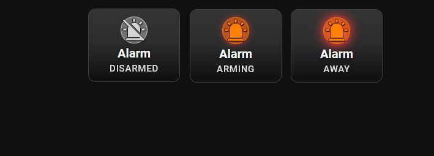
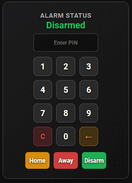

# 🚨 Advanced Alarm Status

A card for `alarm_control_panel` entities. It shows the alarm state as a short text and marks an active alarm with a glowing icon.



## What you get

- The card turns ON when the alarm is armed or active. It is OFF when the alarm is disarmed.
- The states that turn the card ON: `armed_home`, `armed_away`, `armed_night`, `armed_vacation`, `armed_custom_bypass`, `pending`, `arming` and `triggered`.
- The state badge shows the name of the state from Home Assistant, in your language and in capital letters, for example `ARMED AWAY` or `DISARMED`. Every language of Home Assistant works.
- In every ON state, the icon pulses with a red glow.
- The icon uses `icon_color` when the alarm is disarmed and `icon_color_on` in the ON states. You can set a different icon for the on state with `icon_on`.
- Tap toggles the entity. Double-tap does nothing by default, and a long press works like a normal tap until you set a hold action. For an alarm panel, you will usually want to set tap to **More info** in the **⚡ Actions** tab.
- These options work as usual: `name`, `icon`, `icon_style`, `tap_action`, `double_tap_action`, `hold_action`.

If you do not set `icon`, the card shows the default `mdi:lightning-bolt`.

## State badge texts

The texts come from Home Assistant itself, so they are in the language of your Home Assistant. In an English Home Assistant, you see `DISARMED`, `ARMED HOME`, `ARMED AWAY`, `ARMED NIGHT`, `ARMED VACATION`, `ARMED CUSTOM BYPASS`, `PENDING`, `ARMING` and `TRIGGERED`.

If Home Assistant cannot give a name for a state, the card shows the state in capital letters, with spaces instead of underscores, for example `ARMED AWAY`.

The names can be long. On a narrow card, a long name goes to a second or a third line. If this does not look good, you can lower the **State font size** (`state_size`), make the card wider, or write your own short text for each state, as described below.

## Setup

No extra switch is needed. Enter the alarm entity in the **⚙️ General** tab and the card works.

The **📝 Text** tab has **Custom state (ON)** (`name_on`) and **Custom state (OFF)** (`name_off`). Fill in both. If both are set, they replace all state texts, so the badge shows only two texts: one for all ON states and one for disarmed. Leave them empty to keep the texts per state.

### Your own short text for each state

To change the text of single states, use `custom_states_labels` in YAML. Your text is checked first. For a state that you did not write, the card uses the name from Home Assistant.

```yaml
custom_states_labels:
  armed_home: HOME
  armed_away: AWAY
  armed_night: NIGHT
  armed_vacation: VACATION
  armed_custom_bypass: BYPASS
  disarmed: OFF
```

## 📋 Full example from screenshot

```yaml
type: custom:piotras-smart-button
entity: alarm_control_panel.test_alarm
name: Alarm
card_width: 150
card_height: 120
icon: mdi:alarm-light-off
icon_on: mdi:alarm-light
icon_color: '#d4d4d4'
icon_color_on: '#ff8000'
icon_size: 40
icon_wrap_size: 42
name_size: 20
state_size: 15
background_color1: '#c0c0c037'
border_width: 1
tap_action:
  action: more-info
```

On a small card like this, a long name such as `ARMED CUSTOM BYPASS` goes to more lines. For short texts, add `custom_states_labels` from the section above.

## Go further

Everything above works from the visual editor. For special options, see the guides:

- 🏷️ [Custom State Labels](custom_states_labels_3.md) — your own text for each state
- 🎛️ [Custom States On & Blockade](custom_states_on_and_custom_blockade_3.md) — decide what counts as "on" and lock the card
- 👁️ [Conditional Visibility](visible_if_3.md) — show or hide the card
- 🧩 [Custom Data & Templates](custom_data_guide_3.md) — your own logic in JavaScript
- 🖱️ [Custom Tap](custom_tap_3.md) — clickable elements and your own panels
- ⚙️ [Configuration Reference](configuration_3.md) — the full list of options

## 🛠️ Ready-to-Use

> 🧩 **[Interactive Alarm Control Panel (`alarmPanelHtml`)](https://github.com/Piotras1/piotras-smart-button/discussions/21)**
>
> <a href="https://github.com/Piotras1/piotras-smart-button/discussions/21"></a>  

## More ideas

* 🙌 [Show and Tell](https://github.com/Piotras1/piotras-smart-button/discussions/categories/show-and-tell) — Dashboards and setups shared by the community — good for ideas.
* 🧩 [Custom Data & Modules](https://github.com/Piotras1/piotras-smart-button/discussions/categories/custom-data-modules) — Ready-made custom_data modules to copy and paste.

---

> 🔙 Back to the [Main README](../README.md)
