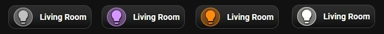

# 🔘 Chip Buttons

A small, compact version of the card. You make it by setting a small card size and moving the icon and the name into one row. A chip works with any entity from the other guides.



## What you get

- A card as small as a single row, for example 140 × 40 px. The default card is 140 × 120 px.
- The icon and the name sit side by side. You pick their places in the **🔲 Layout** tab.
- Rounded corners up to a full pill shape with **Border radius**.
- Everything else works as on any other card: name, icon, colors, size and actions.

A chip has no room for the slider bar, the power bar or the state badge. The bar always takes the bottom row of the card, so leave **Show slider or power bar** off. Hide the state badge with **Show entity state**.

## Setup

**Size.** Open the **📐 Size** tab:

- **Card width** (`card_width`) — a number in px, a percent such as `100%`, or `auto`.
- **Card height** (`card_height`) — a number in px, or `auto`. With `auto`, the card takes the height of its row, with a minimum of the wrap size plus 32 px.
- **Border radius (px)** (`border_radius`, 0–80) — use a high value for a pill shape.

**Icon.** Open the **💡 Icon** tab:

- **Icon size (px)** (`icon_size`, 10–100) — make it smaller, for example 18.
- **Wrap size (px)** (`icon_wrap_size`, 20–120) — the circle or square behind the icon. The default is 48. Use about 30 for a chip.

**Name.** Open the **📝 Text** tab:

- **Name font size (px)** (`name_size`, 6–40) — for a chip, 11–13 is a good start.

**Layout.** Open the **🔲 Layout** tab. There are three grids: **Icon**, **Name** and **State**. Each grid has nine places:

| | | |
|---|---|---|
| ↖️ `1` | ⬆️ `2` | ↗️ `3` |
| 🟢 `4` | 🔵 `5` | 🟢 `6` |
| ↙️ `7` | ⬇️ `8` | ↘️ `9` |

Elements in the same place stack: icon, then name, then state. The default for all three is `5`, the center. For a chip, set **Icon** to `4` (left) and **Name** to `6` (right).

**State.** Open the **⚙️ General** tab. In the **Visibility** section, switch off **Show entity state** (`show_state: false`).

## Minimal example

```yaml
type: custom:piotras-smart-button
entity: light.living_room
name: Living Room
card_width: 140
card_height: 40
icon: mdi:lightbulb
icon_wrap_size: 30
icon_mode: 4
name_mode: 6
show_state: false
```

The minimal example uses the default icon. Add `icon: mdi:lightbulb` to set your own.

<details>
<summary>📋 <code>Full example from screenshot</code></summary>
<br>

```yaml
type: custom:piotras-smart-button
entity: light.living_room
name: Living Room
card_width: 140
card_height: 40
icon: mdi:lightbulb
icon_color_on: auto
icon_color: '#c0c0c0'
icon_wrap_size: 30
icon_mode: 4
name_mode: 6
show_state: false
background_color1: '#80808044'
border_width: 1
tap_action:
  action: toggle
hold_action:
  action: more-info
```

`icon_color_on: auto` takes the icon color from the light. In this example, hold opens more-info.

</details>

## Go further

Everything above works from the visual editor. For special options, see the guides:

- 🏷️ [Custom State Labels](custom_states_labels_3.md) — your own text for each state
- 🎛️ [Custom States On & Blockade](custom_states_on_and_custom_blockade_3.md) — decide what counts as "on" and lock the card
- 👁️ [Conditional Visibility](visible_if_3.md) — show or hide the card
- 🧩 [Custom Data & Templates](custom_data_guide_3.md) — your own logic in JavaScript
- 🖱️ [Custom Tap](custom_tap_3.md) — clickable elements and your own panels
- ⚙️ [Configuration Reference](configuration_3.md) — the full list of options

## More ideas

* 🙌 [Show and Tell](https://github.com/Piotras1/piotras-smart-button/discussions/categories/show-and-tell) — Dashboards and setups shared by the community — good for ideas.
* 🧩 [Custom Data & Modules](https://github.com/Piotras1/piotras-smart-button/discussions/categories/custom-data-modules) — Ready-made custom_data modules to copy and paste.

---

> 🔙 Back to the [Main README](../README.md)
