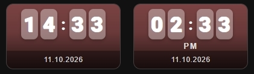

# 🕒 Clock

A clock card. It shows the current time in four styles and, if you want, the date. It does not use a Home Assistant entity. You turn it on with a special entity name: `on.clock`.



## What you get

- The card switches to clock mode when `entity` is `on.clock`. The entity does not need to exist in Home Assistant.
- Four clock styles: digits, flip tiles, analog and LED.
- 24-hour format by default. You can switch to 12-hour format with AM/PM.
- A date bar at the bottom of the card in the format `DD.MM.YYYY`, for example `09.10.2026`.
- The clock replaces the name, so `name` does not show on this card.
- The card always looks active. It has no ON and OFF state.
- Tap does nothing by default. You can set your own action for tap, double-tap and hold in the **⚡ Actions** tab.
- These options work as usual: `show_icon`, `icon`, `icon_style`, `card_width`, `card_height`, `border_radius`, background and filters.

## Setup

Enter `on.clock` in **Entity** in the **⚙️ General** tab. The **Clock display** section appears below, with three options:

- **Clock style** (`clock_mode`) — `1` digits (default), `2` flip tiles, `3` analog, `4` LED.
- **Tile / face background** (`clock_tile_bg`) — the background color of the tiles, the analog face or the LED panel. If you leave it empty, the card uses a default semi-transparent color.
- **12-hour format (AM/PM)** (`clock_12h`) — switches from 24-hour to 12-hour format.

| Clock style | What you see |
|---|---|
| `1` Digits | Large numbers with a blinking colon |
| `2` Flip tiles | Hours and minutes on separate tiles |
| `3` Analog | A round face with hands |
| `4` LED | Numbers in the style of an LED display |

In the **📝 Text** tab, the **Clock** section has:

- **Clock font size** (`name_size`, 6–60 px) — the size of the clock.
- **Clock color** (`text_color`) — the color of the digits, hands or LED.

To show the date, open the **🎚 Slider & Power** tab and switch on **Show slider or power bar** (`show_more: true`). On a clock card, this bar shows the date. You can also set the **Bar height** (`slider_height`) and the **Label color** (`slider_label_color`) there.

## 📋 Full example from screenshot

```yaml
type: custom:piotras-smart-button
entity: on.clock
clock_mode: 2
show_icon: false
show_name: false
show_state: false
show_more: true
name_size: 37
card_width: 190
name_mode: 2
card_height: 110
clock_12h: true
slider_height: 30
background_color1: '#ff808077'
border_width: 1
```

`clock_12h: true` switches between 12-hour (true) and 24-hour (false, default) clock display.

## Go further

Everything above works from the visual editor. For special options, see the guides:

- 🏷️ [Custom State Labels](custom_states_labels_3.md) — your own text for each state
- 🎛️ [Custom States On & Blockade](custom_states_on_and_custom_blockade_3.md) — decide what counts as "on" and lock the card
- 👁️ [Conditional Visibility](visible_if_3.md) — show or hide the card
- 🧩 [Custom Data & Templates](custom_data_guide_3.md) — your own logic in JavaScript
- 🖱️ [Custom Tap](custom_tap_3.md) — clickable elements and your own panels
- ⚙️ [Configuration Reference](configuration_3.md) — the full list of options

## More ideas

* 🙌 [Show and Tell](https://github.com/Piotras1/piotras-smart-button/discussions/categories/show-and-tell) — Dashboards and setups shared by the community — good for ideas.
* 🧩 [Custom Data & Modules](https://github.com/Piotras1/piotras-smart-button/discussions/categories/custom-data-modules) — Ready-made custom_data modules to copy and paste.

---

> 🔙 Back to the [Main README](../README.md)
