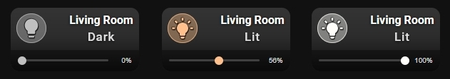
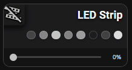

# 💡 Light & Auto-Dimmer Slider

A card for `light` entities. It shows the light state and adds sliders for brightness and color temperature when the light supports them.



## What you get

- Tap toggles the light. Double-tap and hold do nothing by default. You can set all three in the **⚡ Actions** tab.
- The state badge shows `OFF` when the light is off, `DIM` when it is on and supports brightness, and `ON` when it is on without brightness.
- The icon uses `icon_color` when the light is off and `icon_color_on` when it is on. You can set a different icon for the on state with `icon_on`.
- A brightness slider (1–100%) appears automatically if the light reports brightness.
- A color temperature slider appears automatically if the light reports color temperature. The label shows kelvin or mireds, depending on what the light provides.
- These options work as usual: `name`, `name_on`, `name_off`, `icon`, `icon_style`, `tap_action`, `double_tap_action`, `hold_action`.

## Setup

- Open the **🎚 Slider & Power** tab and switch on Show slider or power bar (show_more: true). Without it, sliders are not shown.
- In the same tab, you can set the Bar height (slider_height, 16–60 px) and the Label color (slider_label_color).
- To change the state text, use the 📝 Text tab: Custom state (ON) (name_on) and Custom state (OFF) (name_off). Fill in both. If only one is set, the card ignores them.
- To configure icon colors, use the following options:
   - icon_color: '#c0c0c0' — sets the default icon color when the entity is OFF.
   - icon_color_on: auto — when set to auto, the icon dynamically inherits the entity's active color (e.g., current light color/temperature).

## 📋 Full example from screenshot

```yaml
type: custom:piotras-smart-button
entity: light.living_room
name: Living Room
icon: mdi:lightbulb
icon_on: mdi:lightbulb-on
icon_color: '#c0c0c0'
icon_color_on: auto
icon_size: 32
name_on: Lit
name_off: Dark
show_more: true
slider_height: 30
card_width: 180
card_height: 90
icon_mode: 1
name_mode: 3
value_mode: 3
icon_wrap_size: 40
name_size: 16
state_size: 17
background_color1: '#c0c0c037'
tap_action:
  action: toggle
hold_action:
  action: more-info
```


## Go further

Everything above works from the visual editor. For special options, see the guides:

- 🏷️ [Custom State Labels](custom_states_labels_3.md) — your own text for each state
- 🎛️ [Custom States On & Blockade](custom_states_on_and_custom_blockade_3.md) — decide what counts as "on" and lock the card
- 👁️ [Conditional Visibility](visible_if_3.md) — show or hide the card
- 🧩 [Custom Data & Templates](custom_data_guide_3.md) — your own logic in JavaScript
- 🖱️ [Custom Tap](custom_tap_3.md) — clickable elements and your own panels
- ⚙️ [Configuration Reference](configuration_3.md) — the full list of options

## 🛠️ Ready-to-Use

> 🧩 **[Hybrid LED Strip Controller (`lightColorPanel`)](https://github.com/Piotras1/piotras-smart-button/discussions/23)**
>
> <a href="https://github.com/Piotras1/piotras-smart-button/discussions/23"></a>  


## More ideas

* 🙌 [Show and Tell](https://github.com/Piotras1/piotras-smart-button/discussions/categories/show-and-tell) — Dashboards and setups shared by the community — good for ideas.
* 🧩 [Custom Data & Modules](https://github.com/Piotras1/piotras-smart-button/discussions/categories/custom-data-modules) — Ready-made custom_data modules to copy and paste.

---

> 🔙 Back to the [Main README](../README.md)
