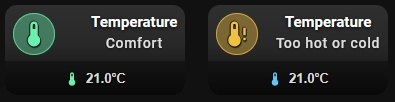

# 🌡️ Temperature Comfort

A card for temperature sensors. It works with any entity that has `device_class: temperature`. You set a comfort range, and the card shows whether the current value is inside it.



## What you get

- The card turns ON when the temperature is inside your comfort range (`comfort_min` to `comfort_max`, both values included). It is OFF when the value is outside the range.
- Without a comfort range, the card is always OFF. Set both values.
- The comfort range is in °C. If your sensor reports °F, the card converts the value to °C before it compares it. You do not need to convert anything.
- The icon is `mdi:thermometer` when the value is in range and `mdi:thermometer-alert` when it is not. You can replace it with your own `icon` and `icon_on`.
- The icon uses `icon_color` when the card is off and `icon_color_on` when it is on.
- A bar at the bottom of the card shows the current value with one decimal place and the unit of the sensor, for example `21.5°C`. It appears when you switch on the slider bar.
- The thermometer icon in the bar changes color with the range: blue when the value is below the range, green when it is inside, red when it is above. Without a comfort range, the bar icon uses the label color.
- The state badge shows `ON` when the value is in range and `OFF` when it is not.
- Tap toggles the entity. Double-tap and hold do nothing by default. For a sensor, you will usually want to change tap to **More info** in the **⚡ Actions** tab.
- These options work as usual: `name`, `name_on`, `name_off`, `icon`, `icon_on`, `icon_style`, `tap_action`, `double_tap_action`, `hold_action`.

## Setup

Open the **🎚 Slider & Power** tab and switch on **Show slider or power bar** (`show_more: true`). In the **Comfort range** section, fill in:

- **Comfort min** (`comfort_min`) — the lowest comfortable temperature in °C.
- **Comfort max** (`comfort_max`) — the highest comfortable temperature in °C.

The editor accepts values from -50 to 100 in steps of 0.5.

In the same tab you can set the **Bar height** (`slider_height`, 16–60 px) and the **Label color** (`slider_label_color`).

To change the state text, use the **📝 Text** tab: **Custom state (ON)** (`name_on`) and **Custom state (OFF)** (`name_off`). For example, `Comfort` and `Too hot or cold`. Fill in both. If only one is set, the card ignores them.

## 📋 Full example from screenshot

```yaml
type: custom:piotras-smart-button
entity: sensor.sonoff_termometr_salon_temperature
name: Temperature
card_width: 180
card_height: 90
icon_color: '#f0c040'
icon_color_on: '#69f0ae'
icon_size: 30
icon_wrap_size: 40
name_size: 15
state_size: 14
icon_mode: 1
name_mode: 3
value_mode: 3
name_on: Comfort
name_off: Too hot or cold
show_more: true
comfort_min: 20
comfort_max: 24
slider_height: 34
background_color1: '#ffffff22'
tap_action:
  action: more-info
```

## Go further

Everything above works from the visual editor. For special options, see the guides:

- 🏷️ [Custom State Labels](custom_states_labels_3.md) — your own text for each state
- 🎛️ [Custom States On & Blockade](custom_states_on_and_custom_blockade_3.md) — decide what counts as "on" and lock the card
- 👁️ [Conditional Visibility](visible_if_3.md) — show or hide the card
- 🧩 [Custom Data & Templates](custom_data_guide_3.md) — your own logic in JavaScript
- 🖱️ [Custom Tap](custom_tap_3.md) — clickable elements and your own panels
- ⚙️ [Configuration Reference](configuration_3.md) — the full list of options

## More ideas

* 🙌 [Show and Tell](https://github.com/Piotras1/piotras-smart-button/discussions/categories/show-and-tell) — Dashboards and setups shared by the community — good for ideas.
* 🧩 [Custom Data & Modules](https://github.com/Piotras1/piotras-smart-button/discussions/categories/custom-data-modules) — Ready-made custom_data modules to copy and paste.

---

> 🔙 Back to the [Main README](../README.md)
