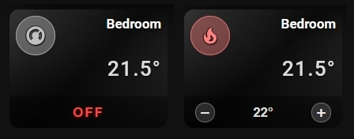
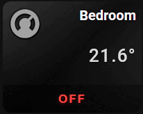

# 🌡️ Thermostat

A card for `climate` entities. It shows the room temperature and lets you change the target temperature with − and + buttons.



## What you get

- The state badge shows the current room temperature, for example `21.5°`.
- The card turns ON when the thermostat is heating or cooling. It turns OFF in every other case, so the icon uses `icon_color_on` only during active heating or cooling.
- The icon uses `icon_color` when the card is off and `icon_color_on` when it is on. You can set a different icon for the on state with `icon_on`.
- A bar with − and + buttons appears at the bottom of the card when you switch on the slider bar. It shows the target temperature. Each tap changes it by 0.5°.
- The bar respects the minimum and maximum temperature of the thermostat. If the thermostat does not report them, the card uses 5° and 35°.
- When the thermostat is off, the bar shows `OFF` and has no buttons.
- Tap toggles the entity. Double-tap and hold do nothing by default. You can set all three in the **⚡ Actions** tab.
- These options work as usual: `name`, `icon`, `icon_style`, `tap_action`, `double_tap_action`, `hold_action`.

## Setup

Open the **🎚 Slider & Power** tab and switch on **Show slider or power bar** (`show_more: true`). Without it, the − and + buttons are not shown.

In the same tab you can set the **Bar height** (`slider_height`, 16–60 px) and the **Label color** (`slider_label_color`).

For a climate entity, the **📝 Text** tab does not offer **Custom state (ON)** and **Custom state (OFF)**. The state badge always shows the room temperature.

## 📋 Full example from screenshot

```yaml
type: custom:piotras-smart-button
entity: climate.your_termostat
name: Bedroom
icon: mdi:thermostat
icon_on: mdi:fire
icon_color: '#c0c0c0'
icon_color_on: '#ff8080'
icon_size: 28
show_more: true
slider_height: 40
card_width: 200
card_height: 150
icon_mode: 1
name_mode: 3
value_mode: 6
name_size: 17
state_size: 26
background_color1: '#c0c0c037'
background_color3: '#c0c0c037'
background_color2: '#00000033'
hold_action:
  action: more-info
tap_action:
  action: toggle
```

## Go further

Everything above works from the visual editor. For special options, see the guides:

- 🏷️ [Custom State Labels](custom_states_labels_3.md) — your own text for each state
- 🎛️ [Custom States On & Blockade](custom_states_on_and_custom_blockade_3.md) — decide what counts as "on" and lock the card
- 👁️ [Conditional Visibility](visible_if_3.md) — show or hide the card
- 🧩 [Custom Data & Templates](custom_data_guide_3.md) — your own logic in JavaScript
- 🖱️ [Custom Tap](custom_tap_3.md) — clickable elements and your own panels
- ⚙️ [Configuration Reference](configuration_3.md) — the full list of options

## 🛠️ Ready-to-Use

> 🧩 **[Hybrid Thermostat Presets (hybrid_thermostat)](https://github.com/Piotras1/piotras-smart-button/discussions/24)**
>
> <a href="https://github.com/Piotras1/piotras-smart-button/discussions/24"></a>  

## More ideas

* 🙌 [Show and Tell](https://github.com/Piotras1/piotras-smart-button/discussions/categories/show-and-tell) — Dashboards and setups shared by the community — good for ideas.
* 🧩 [Custom Data & Modules](https://github.com/Piotras1/piotras-smart-button/discussions/categories/custom-data-modules) — Ready-made custom_data modules to copy and paste.

---

> 🔙 Back to the [Main README](../README.md)
